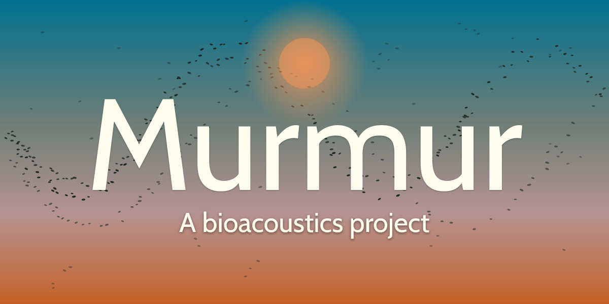

# Murmur



Murmur is a bioacoustics project for detecting bird calls and identifying species offline. It combines a Python model-development pipeline with a Rust desktop proof of concept, with the longer-term aim of running inference on a small field device and sending detections to a home server.

The desktop pipeline exists and is under active development. The field device, radio gateway, server ingestion service, and dashboard described below are planned components rather than completed ones.

## Current state

### Implemented

- DCASE 2018 audio-dataset extraction, preprocessing, spectrogram generation, and manifest creation in Python.
- A PyTorch convolutional classifier, called Sparrowhawk, for bird/not-bird detection.
- Three-way dataset cross-validation, deterministic reruns, training-only augmentation, early stopping, and threshold selection.
- ONNX export and static INT8 QDQ quantisation, with evaluation code for the float and quantised models.
- Rust WAV loading, 32 kHz resampling, mel-spectrogram generation, and ONNX Runtime inference.
- A two-stage pipeline in which Sparrowhawk gates the more expensive Perch species-identification model.
- SQLite persistence for units, deployments, model metadata, labels, and detections.
- Weather, air-quality, and moon-phase context through Open-Meteo and local calculation.

### In progress

- Validating thresholds and behaviour across the end-to-end desktop pipeline.
- Improving tests, error handling, and documentation around the Python/Rust boundary.
- Separating example deployment configuration from code.
- Preparing a reproducible public snapshot without the private repository history, models, datasets, logs, or generated environmental data.

### Planned

- Select and validate the field-device hardware.
- Run the inference pipeline continuously on that device without a network dependency.
- Transmit compact detection records through a low-power gateway.
- Ingest detections on the home server and expose them through a dashboard.
- Publish reproducible accuracy, model-size, memory-use, and latency measurements.

## Architecture

```text
Audio datasets
      |
Python preparation, training, evaluation, export, and quantisation
      |
Sparrowhawk ONNX model + threshold       Perch ONNX model + labels
      |                                      |
      +--------------- Rust desktop pipeline +
                              |
                 audio -> detection -> species
                              |
                 SQLite detection records
                              |
              environmental context (optional)
```

The eventual field system is planned as:

```text
Starling field device -> Tern gateway -> Nest server -> Roost dashboard
```

Only the desktop model-development and inference path is implemented at present.

## Python model pipeline

The `sparrowhawk/` package contains the model code and the `tools/` package prepares its data.

### Data preparation

- `tools/process_data/` extracts the DCASE 2018 development datasets, resamples audio, precomputes spectrograms, and writes a manifest.
- The manifest keeps each clip's dataset and bird/not-bird label with its processed path.
- Raw audio and processed arrays live under the ignored `data/` directory and are not included in this snapshot.

### Training and evaluation

- `sparrowhawk/model.py` defines the convolutional classifier.
- `sparrowhawk/data.py` handles the three dataset folds and applies augmentation to training data only.
- `sparrowhawk/train.py` runs training, validation, early stopping, and test evaluation with deterministic settings.
- `sparrowhawk/export.py` exports a trained checkpoint to ONNX.
- `sparrowhawk/quantise.py` performs static INT8 quantisation.
- `sparrowhawk/eval.py` selects and records the deployment threshold.
- `python -m sparrowhawk` runs the training, export, quantisation, and evaluation stages in sequence.

The code records AUC, loss, recall, accuracy, false positives, false negatives, and inference time. This README does not publish a headline result because a final reproducible model and deployment measurement have not been selected.

## Rust desktop proof of concept

The Rust crate in `src/` joins audio preprocessing, inference, context, and persistence.

- `audio.rs` loads WAV files, resamples them to 32 kHz, and produces mel spectrograms.
- `model.rs` provides shared ONNX Runtime loading and inference helpers.
- `sparrowhawk.rs` applies the first-stage bird/not-bird classifier and its saved threshold.
- `perch.rs` splits flagged audio into chunks and returns the highest-scoring species prediction for each one.
- `db.rs`, `unit.rs`, and `detection.rs` initialise SQLite state and persist detection records without duplicating the same sequence number.
- `open_meteo.rs` and `moon.rs` prepare optional environmental context.

The example unit values in `src/unit.rs` are deliberately non-deployment placeholders. Real identifiers and locations should come from private configuration rather than source code.

## Data model

`schema.sql` defines the current SQLite design, including:

- units and deployments;
- model versions and labels;
- detections and their sequence numbers;
- current and daily weather observations;
- air-quality observations; and
- moon-phase observations.

The schema is ahead of parts of the desktop program. Its presence records the intended persisted structure, not a claim that every table is populated end to end.

## Set-up

### Python environment

1. Create and activate a virtual environment.
2. Install the packages in `requirements.txt`.
3. Download the DCASE 2018 development datasets referenced at the top of `tools/process_data/process_data.py`.
4. Run `python -m tools.setup` to create the ignored working directories.
5. Run `python -m tools.process_data.process_data` to prepare the datasets and manifest.
6. Optionally run `python -m tools.benchmark_workers` and adjust the worker count for the machine.
7. Run `python -m sparrowhawk` for the complete model pipeline, or invoke an individual stage while developing it.

The repository does not contain datasets, model files, logs, or trained checkpoints.

### Rust environment

The Rust proof of concept expects the generated Sparrowhawk ONNX model and threshold, the Perch model and label file, and representative WAV inputs in the ignored data layout referenced by the source. Run it with `cargo run` once those local assets are present.

The current executable uses development file paths and example deployment values. It is not yet a packaged application or field-device service.

## Testing and reproducibility

- Training uses fixed seeds and deterministic cuDNN settings where supported.
- Dataset folds are explicit and the selected validation split is saved for reuse by later stages.
- Quantisation calibration and evaluation reuse the recorded split instead of deriving a different one.
- The Rust pipeline can be rerun against the same WAV inputs; detection sequence numbers prevent duplicate rows.

The repository does not yet have a single automated test command covering both languages. Adding unit and integration tests around audio shapes, model inputs, database writes, and failure handling remains in progress.

## Project names

| Name | Component | State |
| :--- | :--- | :--- |
| **Murmur** | The project as a whole | Active |
| **Sparrowhawk** | Bird/not-bird classifier | Implemented in the desktop pipeline |
| **Perch** | Species-identification model | Implemented in the desktop pipeline |
| **Starling** | Field device | Planned |
| **Tern** | Radio gateway | Planned |
| **Nest** | Home-server ingestion and storage | Planned |
| **Roost** | Detection dashboard | Planned |

## Publication notes

This directory is a fresh snapshot rather than a copy of the private Git history. Generated environment data and deployment-specific location values have been removed. Before any public release, the snapshot still needs a dependency review, a working-tree secret scan, build and test checks on a machine with the required model assets, and an explicit licence decision.
