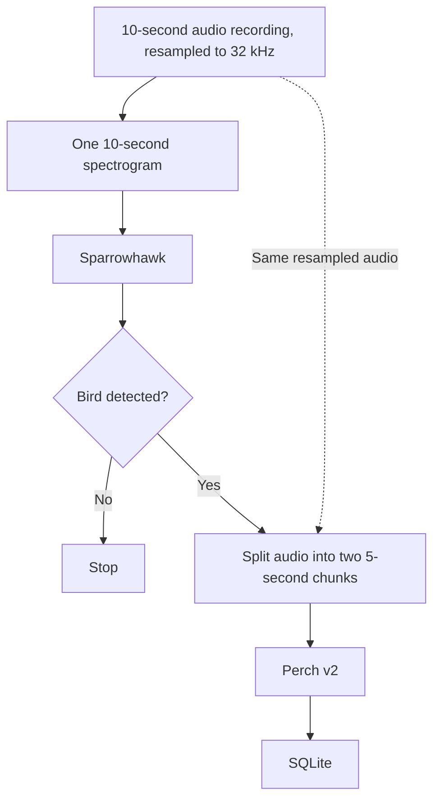

# Murmur

*A bioacoustics project for bird detection and species identification.*

## Overview

Murmur is a bioacoustics project exploring bird-activity detection using machine learning, with the longer-term goal of monitoring wildlife in remote locations through low-power field devices.

The current desktop proof of concept processes prerecorded WAV files through two machine-learning models. Sparrowhawk, a custom classifier trained using Python and PyTorch, detects bird activity before Google's Perch v2 model identifies likely species. Rust handles audio processing, ONNX inference and SQLite storage.

> [!NOTE]
> Development has slowed while I focus on university work and other projects. Murmur remains a desktop proof of concept, and I plan to resume more active development soon. Live audio capture, field hardware and wireless networking are not yet implemented.

## Features

The current desktop proof of concept includes:

- **Two-stage bird detection:** A custom Sparrowhawk classifier detects likely bird activity before passing positive recordings to Google's Perch v2 model for species identification.
- **Model development:** Python and PyTorch tools for dataset preparation, training, evaluation, ONNX export and static INT8 quantisation.
- **Rust audio processing:** WAV loading, resampling to 32 kHz and log-mel spectrogram generation.
- **ONNX inference:** Execution of Sparrowhawk and Perch v2 from Rust using ONNX Runtime.
- **SQLite storage:** Persistence of species detections and supporting model metadata, with sequence numbers to prevent duplicate results.
- **Environmental data:** Weather and air-quality retrieval through Open-Meteo, alongside local moon-phase calculations, currently saved separately from detection records.

## Detection Pipeline

Murmur uses a two-stage detection pipeline. Sparrowhawk first checks whether a recording contains likely bird activity. Only positive results are passed to Perch v2 for species identification.



Rust handles audio preparation and inference using ONNX Runtime. Sparrowhawk receives a log-mel spectrogram, while Perch processes two five-second chunks of the resampled waveform. Successful species predictions are then stored in SQLite.

The initial Sparrowhawk stage is intended to avoid running the larger species model unnecessarily. Its potential performance and power-saving benefits still need to be evaluated on field hardware.

See [Model Pipeline](docs/model-pipeline.md) for more detail on preprocessing, model training, ONNX export and quantisation.

## Tech Stack

| Category | Technologies |
| :-- | :-- |
| **Languages** | Python, Rust |
| **Models** | Sparrowhawk (PyTorch CNN), Google Perch v2 |
| **Training & Evaluation** | PyTorch, librosa, scikit-learn |
| **Model Inference** | ONNX, ONNX Runtime (`ort`) |
| **Audio Processing** | `hound`, `rubato`, `spectrs` |
| **Database** | SQLite (`rusqlite`) |
| **Environmental Data** | Open-Meteo (`reqwest`), `moontool` |

## Development

Murmur currently consists of a Python model-development pipeline and a Rust desktop runner. The Rust application processes prerecorded WAV files rather than capturing live audio.

### Repository Structure

| Path | Purpose |
| :-- | :-- |
| `tools/process_data/` | Dataset preparation and audio preprocessing |
| `sparrowhawk/` | Model training, evaluation, ONNX export and quantisation |
| `src/` | Rust audio processing, inference and database integration |
| `schema.sql` | SQLite database schema |

### Running Locally

The Python pipeline requires the dependencies in `requirements.txt` and the relevant DCASE bird-audio datasets.

The Rust runner requires the exported Sparrowhawk model and threshold, a Perch v2 ONNX model and label list, and representative WAV files. These generated and third-party files are not included in the repository.

The current development entry points are:

```bash
# Python model-development pipeline
python -m tools.setup
python -m tools.process_data.process_data
python -m sparrowhawk

# Rust desktop runner
cargo run
```

These commands reflect the current development workflow. Model paths and input configuration still need to be made more flexible, and the latest complete end-to-end execution has not yet been reverified.

See [Development](docs/development.md) for additional setup information and requirements.

## Documentation

More detailed information about Murmur is available in the `docs/` directory.

| Document | Description |
| :-- | :-- |
| [Architecture](docs/architecture.md) | Desktop components and the proposed field-device system |
| [Model Pipeline](docs/model-pipeline.md) | Audio preprocessing, training, ONNX export and inference |
| [Data and Persistence](docs/data-and-persistence.md) | SQLite schema, detection storage and environmental data |
| [Development](docs/development.md) | Development setup, dependencies and testing requirements |
| [Roadmap](docs/roadmap.md) | Current development work and longer-term plans |
| [Glossary](docs/glossary.md) | Project terminology, model names and component definitions |
| [Logging Standards](docs/logging-standards.md) | Log format and conventions used across the Python and Rust code |

> **Documentation status:** Apart from Logging Standards, the supporting documents are currently AI-generated drafts. I'm reviewing their contents and will replace them with human-written versions as I work through them.

## Roadmap

**Current Status:** Desktop proof of concept using prerecorded audio. Live audio capture, field hardware and wireless networking are not yet implemented.

**Current Focus:** Making the desktop pipeline reproducible, configurable and thoroughly tested before moving to field hardware.

- [x] Prepare the DCASE datasets and train Sparrowhawk using PyTorch.
- [x] Export Sparrowhawk to ONNX, including static INT8 quantisation and a saved detection threshold.
- [x] Implement Rust audio processing and two-stage Sparrowhawk/Perch inference.
- [x] Store detections in SQLite and collect environmental information separately.
- [ ] **Complete the desktop pipeline, including folder processing, configuration, environmental data integration and testing.**
- [ ] Build the first Starling field device with live audio capture, local inference and offline storage.
- [ ] Evaluate and improve field-device performance, power consumption and outdoor reliability.
- [ ] Investigate low-power wireless communication and develop the Tern gateway.
- [ ] Build Nest and Roost, connecting the field device, gateway, storage and dashboard.
- [ ] Build and deploy a second Starling using only the documentation (v1.0).

This is a brief overview rather than a fixed schedule. See the [detailed roadmap](docs/roadmap.md) for additional milestones and ideas.

## Licence

[Apache-2.0](LICENSE)

## Acknowledgements

- [DCASE 2018 Bird Audio Detection](https://dcase.community/challenge2018/task-bird-audio-detection) - the `freefield1010`, `warblrb10k` and `BirdVox-DCASE-20k` datasets used to train Sparrowhawk.
- [Google Perch v2](https://www.kaggle.com/models/google/bird-vocalization-classifier/tensorFlow2/perch_v2) - the pretrained model used for species identification.

The datasets and pretrained model remain subject to their respective licences and are not distributed with this repository.
