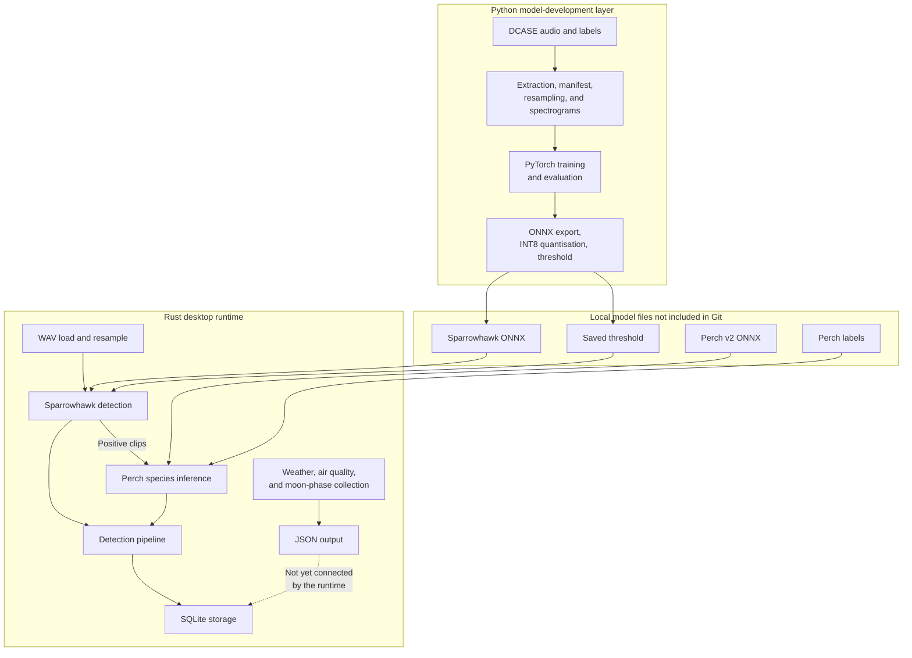
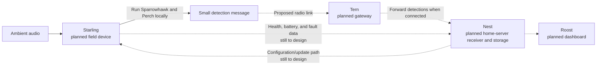

# Murmur architecture

> [!WARNING]
> **Transparency:** this document was generated by AI and will be replaced with a human-written version soon.

The components described as implemented are present in the sanitised codebase. The latest complete run still needs to be rechecked with the model and data files that are not included in this copy.

## Architecture at a glance

- **Python model development:** prepares labelled audio, trains Sparrowhawk, exports ONNX, quantises the model, and selects its threshold.
- **Rust desktop runtime:** prepares WAV audio, runs Sparrowhawk and Perch through ONNX Runtime, and stores species detections in SQLite.
- **Environmental context:** weather and air-quality data come from Open-Meteo; moon phase is calculated locally; the current runner writes this context to JSON rather than linking it to detection rows.
- **Planned field ecosystem:** Starling, Tern, Nest, and Roost are architectural roles only; their applications and transport have not been implemented.

## Implemented desktop component map

## Component responsibilities

| Component | Current responsibility | Current status |
| :-- | :-- | :-- |
| `tools/process_data/` | Extract supported datasets, build manifests, resample audio, and save precomputed spectrogram arrays | Implemented for named DCASE development datasets |
| `sparrowhawk/` | Dataset folds, augmentation, CNN training, ONNX export, INT8 quantisation, and threshold selection | Implemented; final public model/result not selected |
| `src/audio.rs` | WAV input, mono sample conversion, 32 kHz resampling, log-mel spectrograms, and debug PNG output | Implemented for development WAV inputs |
| `src/sparrowhawk.rs` | Fit model input, run the binary ONNX model, apply sigmoid and the saved threshold | Implemented |
| `src/perch.rs` | Load labels, create two five-second waveform inputs, run Perch, and select the highest-scoring label | Implemented for the development runner |
| `src/model.rs` | Shared ONNX Runtime session loading and named input/output execution | Implemented |
| `src/detection.rs` | Load model files, gate Perch behind Sparrowhawk, assign sequence numbers, and store detections | Implemented against a fixed development input map |
| `src/db.rs` and `src/unit.rs` | Initialise SQLite, register an example unit/deployment, and create model/label references | Implemented with publication-safe example unit values |
| `src/open_meteo.rs` and `src/moon.rs` | Retrieve and reduce environmental data, and calculate lunar context | Implemented as separate JSON output; not connected to detections |
| `schema.sql` | Define tables used now and data planned for later | Broader than the rows written by the runtime |

## Current data flow

1. Python loads audio at 32 kHz and precomputes log-scaled 128-bin mel spectrograms.
2. Training reads the arrays, fits them to the configured time dimension, and applies optional training-only augmentation.
3. Export creates a fixed-shape ONNX model and verifies its result against PyTorch.
4. Quantisation creates an INT8 QDQ model using a fixed calibration sample outside the recorded validation split.
5. Rust loads and resamples a development WAV, then recreates the spectrogram parameters for Sparrowhawk.
6. A positive Sparrowhawk result triggers Perch inference on two five-second raw-audio chunks.
7. The highest-scoring Perch label for each chunk is stored with its model version and sequence number.
8. Environmental data is collected separately and written to JSON; database association remains work in progress.

## Engineering choices and trade-offs

- **Two-stage inference:** a small binary gate can avoid unnecessary species inference, but missed Sparrowhawk calls also prevent Perch from seeing the audio.
- **Shared preprocessing parameters:** matching Python and Rust reduces training/runtime drift, but duplicated implementations require explicit tests.
- **ONNX between languages:** separates model development from runtime language, while adding export compatibility and tensor-shape constraints.
- **Static INT8 quantisation:** aims to reduce model size and runtime cost for later edge deployment; actual field-device benefit has not been measured.
- **Precomputed training spectrograms:** reduces repeated training work, at the cost of extra storage and the need to regenerate data after preprocessing changes.
- **SQLite for the proof of concept:** provides structured local storage without needing a separate database server, although the wider multi-device schema is ahead of what the application currently writes.
- **Environmental information kept separate today:** the application can retrieve it, but does not yet store it with detections.

## Proposed field-device ecosystem

None of these four application components has been implemented. The diagram is a proposed direction rather than a fixed deployment design.

### Planned responsibilities

- **Starling:** capture audio, run inference locally, save results while offline, and send small detection messages rather than continuous recordings.
- **Tern:** receive the proposed low-power radio messages and forward them towards the home-server service.
- **Nest:** receive, check, and store detections from one or more field units.
- **Roost:** visualise activity, species detections, history, and device health.
