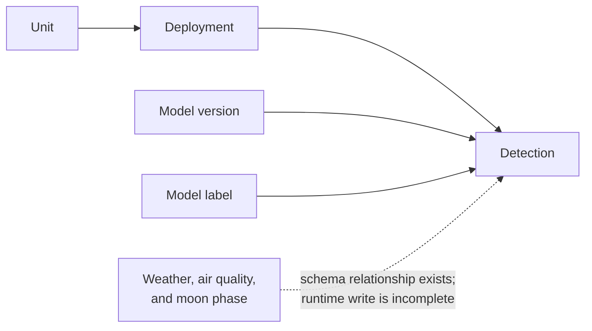

# Murmur data and storage

> [!WARNING]
> **Transparency:** this document was generated by AI and will be replaced with a human-written version soon.

## What the application stores now

- The Rust runner opens `data/murmur.db`, enables SQLite foreign-key enforcement, and applies `schema.sql`.
- A development unit and its open deployment are registered before inference begins.
- The Perch model version is seeded, and species labels are created as they are encountered.
- Each positive Perch result is stored as a detection linked to its deployment, model version, and model label.
- Sequence numbers stop the fixed development inputs being inserted twice when the runner is repeated.
- The runtime does not currently persist a negative Sparrowhawk decision as a detection row.

## Schema scope

### Written by the desktop runner

- Unit and deployment identity.
- Perch model-version metadata.
- Perch labels and their model class indices.
- Species detections, confidence scores, sequence numbers, and supporting references.

### Defined for later stages

- Sites and support for separating data between future users or organisations.
- Taxonomy and species aliases.
- Unit heartbeats and faults.
- Current and daily weather data.
- Air-quality data.
- Moon-phase data.

The later-stage tables are useful design evidence, but should remain described as anticipated schema until runtime writes and queries demonstrate their use.

## Environmental context

- `src/open_meteo.rs` requests current weather, a daily summary, and current air-quality data.
- `src/moon.rs` calculates moon phase locally.
- The current application combines these values into `output/environment.json`.
- Detection rows have schema fields for environmental references, but the present insertion path does not populate them.
- A publication-safe configuration mechanism is still needed for location input; deployment-specific values must not be committed or documented.

## Data included in the publication copy

- Raw and processed development datasets are deliberately excluded from the sanitised publication copy and should not be added to the GitHub repository.
- Public documentation should link to the original [DCASE 2018 Bird Audio Detection datasets](https://dcase.community/challenge2018/task-bird-audio-detection), acknowledge their creators, and describe the expected local layout without redistributing the data.
- Trained models, label files, logs, generated environmental output, and the working SQLite database are also excluded from the publication copy.
- Perch's distribution terms still need checking before publishing any downloadable model or label files.
- It is not yet decided how long field recordings would be kept. The current idea is to keep them on the device and send small detection messages, but this remains a proposed design.

## Reliability and recovery considerations

- SQLite provides simple local storage for the proof of concept, but multiple writers, database upgrades, and long-running service behaviour have not been designed.
- The current database is a generated development file; no formal backup or restore process is documented.
- API failure, partial database writes, corrupt model files, and interrupted inference need explicit tests and error handling.
- Field devices will need a durable local queue or equivalent buffering if the radio path is unavailable.
- Before the network can be considered reliable, the central server will need to identify messages, confirm receipt, handle retries, avoid duplicates, and deal with incorrect device times.
