# Murmur model pipeline

> [!WARNING]
> **Transparency:** this document was generated by AI and will be replaced with a human-written version soon.

## Pipeline overview

```mermaid
flowchart LR
    RAW[DCASE WAV files<br/>and labels] --> MANIFEST[Raw manifest]
    MANIFEST --> SPEC[32 kHz log-mel<br/>spectrogram arrays]
    SPEC --> SPLITS[Dataset fold plus<br/>train, validation, and test split]
    SPLITS --> TRAIN[PyTorch Sparrowhawk training]
    TRAIN --> CHECKPOINT[Selected checkpoint<br/>and saved validation split]
    CHECKPOINT --> EXPORT[ONNX export and<br/>PyTorch comparison]
    EXPORT --> FLOAT[Float ONNX model]
    FLOAT --> QUANT[Static INT8 QDQ<br/>calibration]
    QUANT --> QMODEL[Quantised ONNX model]
    CHECKPOINT --> VAL[Recorded validation rows]
    VAL --> QUANT
    QMODEL --> EVAL[ONNX score sweep]
    VAL --> EVAL
    EVAL --> THRESHOLD[Saved deployment threshold]
    QMODEL --> RUST[Rust ONNX Runtime]
    THRESHOLD --> RUST
```

## Audio preparation

- `librosa.load` resamples source audio to 32 kHz.
- Mel-spectrogram settings in Python and Rust are intended to match:
  - FFT frame: 1,024 samples;
  - analysis window: 640 samples;
  - hop: 320 samples;
  - mel bins: 128;
  - frequency range: 60 Hz to 16 kHz;
  - centred padding disabled in Python.
- Power values are clamped before logarithmic scaling; the scaled arrays are saved as `.npy` files.
- The processed manifest maps each saved spectrogram to its source dataset and binary bird label.
- Full clips are padded or cropped to 1,000 time columns for the current Sparrowhawk input.
- An alternative 500-column random window path exists in the dataset code but is disabled by the current `FULL_CLIP` setting.

## Dataset folds and augmentation

- Three folds rotate `ff1010bird`, `warblrb10k`, and `BirdVox-DCASE-20k` between training and held-out test roles.
- Each fold's training data is divided again for training and validation by the training pipeline.
- The selected validation rows are saved beside the model checkpoint and reused by later stages.
- Optional augmentation is applied only to training examples:
  - frequency and time masking up to the configured width;
  - synthetic green-noise weighting concentrated towards the middle mel bins.
- Clip-level random behaviour is seeded from run, fold, item, and epoch information where random windows are enabled.
- Deterministic cuDNN settings and recorded seeds support reruns, subject to library and hardware limitations.

## Sparrowhawk model

- Purpose: output one raw logit representing bird/not-bird evidence for a spectrogram.
- Input shape used for export: `1 × 1 × 128 × 1000`.
- Four convolution stages use 5×5 kernels, batch normalisation, leaky ReLU, and max pooling.
- The first two stages contain paired convolution blocks.
- Adaptive average pooling reduces the final feature map to 2×2.
- A 128-unit fully connected layer and 0.5 dropout precede the single-logit output.
- The model does not apply sigmoid internally; training loss and deployment code operate from the raw logit as appropriate.
- The saved deployment threshold is selected separately rather than assuming 0.5 is always the desired operating point.

## Training and evaluation

- The training code records loss, AUC, recall, accuracy, false positives, false negatives, and F-beta threshold sweeps.
- Learning-rate reduction and early stopping respond to validation behaviour.
- The best validation checkpoint is restored before test evaluation.
- Fold results are aggregated, including a harmonic AUC calculation intended to penalise a weak dataset fold.
- Smoke-test controls allow a smaller number of folds and seeds before a longer experiment.
- Current code and changelog contain experimental baseline values, but this documentation deliberately does not promote one as the project's final result.

## ONNX export and quantisation

- Export loads the latest versioned PyTorch checkpoint and fixes the ONNX input batch size at one.
- ONNX input name: `mel_spectrogram`.
- ONNX output name: `raw_logit`.
- Export runs the same dummy input through PyTorch and ONNX Runtime, records maximum difference, and checks numerical closeness.
- Static quantisation uses QDQ format with signed INT8 activations and weights.
- Calibration uses 1,000 deterministically sampled rows outside the saved validation split.
- Quantisation code records combined graph/weight size and evaluates float and quantised variants on the same validation rows.
- The timing collected by that script is a development-machine measurement, not yet a field-device benchmark.

## Runtime inference flow

### Sparrowhawk

- Rust recreates the log-mel spectrogram and pads or crops it to 128×1,000.
- Two leading axes produce a `1 × 1 × 128 × 1000` tensor.
- ONNX Runtime returns `raw_logit`; Rust applies sigmoid and compares the probability with the saved threshold.
- A negative result stops the inference path for that WAV file.

### Perch

- A positive Sparrowhawk result sends the resampled waveform to Perch.
- The current runner takes two five-second chunks of 160,000 samples each at 32 kHz.
- Short input is zero-padded to the fixed chunk length.
- Perch input name: `inputs`; output name: `label`.
- The runtime selects the maximum score, applies sigmoid, and records the corresponding label and class index.
- This top-one score handling is the current implementation; calibration and interpretation of Perch scores need further review.

## Testing and limitations

### Existing checks

- PyTorch versus ONNX output comparison during export.
- Shared validation split for quantisation and threshold selection.
- Deterministic calibration sampling.
- Float versus quantised AUC, accuracy, average inference time, and file-size logging.
- Sequence numbers stop repeat runs storing the same detections twice.

### Missing or incomplete checks

- Automated equivalence tests for Python and Rust spectrogram output on the same WAV.
- Unit tests for padding, cropping, chunk boundaries, tensor names, and unexpected model shapes.
- Integration test from WAV through both models into a temporary SQLite database.
- Tests for malformed audio, missing model files, API failure, and database failure.
- A clearly selected final model with enough information to repeat its evaluation.
- Latency, memory, energy, and thermal measurements on the eventual field hardware.
- Field recordings outside the development datasets.
- Confidence calibration and an explicit policy for uncertain Perch results.
